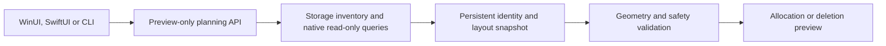

# Milestone 6A: Safe partition management foundations

Date: 12 October 2026.

This milestone implements discovery, eligibility, planning and previews. No partition mutation API exists. A valid preview does not reserve a device or authorize execution. Existing volume management and the four original C exports retain their contracts.

## Architecture

The three Rust crates remain the backend boundary. `diskvio-core::partition_planning` owns portable models, allocation arithmetic, identity resolution, the shared safety policy and create/delete planners. `platform/windows/partition_layout.rs` owns read-only native queries and reconciles their results with the existing Rust-owned Storage inventory. `diskvio-ffi` exposes a separate preview-only entry point. The CLI and native clients consume the same backend results.



Planning has no dependency on the volume execution dispatcher. `DiskOperation` still accepts only mount, unmount, eject, rename and drive-letter actions. Adding `action`, `execute`, `force` or filesystem parameters to planning requests is rejected. Create/delete execution names are still rejected by `diskvio_operation_json`.

## Shared Rust contracts

| Model | Purpose |
| --- | --- |
| `PhysicalDiskIdentity` | Persistent VPD identifier, identifier format and hardware serial; excludes disk number and drive letters. |
| `GptGeometry` | Authoritative disk length, usable half-open GPT interval, sector sizes, alignment offset and entry limit. |
| `PlanningDisk`, `PlanningPartition` | Discovered facts with nullable metadata, GPT attributes, partition GUIDs, safety evidence and associated volumes. These are backend facts, never FFI request input. |
| `PartitionDiskSafety`, `PartitionSafety` | Affirmative eligibility evidence and detailed whole-disk protection. |
| `DiskLayoutSnapshot` | Versioned canonical snapshot token, distinct from persistent hardware identity. |
| `AllocatableRegion` | Parent identity, exact region boundaries, alignment, geometric capacity, safely allocatable capacity and validation issues. |
| `PartitionPlanningRequest` | Closed `discover`, `create` and `delete` request variants. |
| `CreatePartitionPreview` | Exact start, exclusive end, size, alignment and remaining raw/aligned capacity. |
| `DeletePartitionPreview` | Parent disk, partition facts, associated volumes, protection evidence, eligibility and explicit data-loss warning. |
| `PartitionPlanningResponse` | Version 1, `preview_only:true`, `execution_supported:false`, validation, discovery and optional previews. |

Structured issue codes distinguish `unsupported_operation`, `unsupported_platform`, `invalid_parameters`, `protected_target`, `stale_device_identity`, `changed_partition_layout`, `missing_metadata`, `insufficient_allocatable_space`, `invalid_geometry`, `ambiguous_identity`, `device_disappeared`, `permission_denied`, `discovery_failed`, `test_disk_designation_required` and `internal_error`. Native Windows error numbers are retained where available. Rejections can contain several reasons.

## Windows discovery

The existing `Get-Disk`, `Get-Partition` and `Get-Volume` inventory remains Rust-owned. Its optional planning mode additionally queries sector sizes, partition count, `BootFromDisk`, physical-disk pool associations and the BitLocker CIM provider. It probes known Windows/Boot/EFI directories through reported volume roots. Failed or inaccessible probes remain unknown. No frontend invokes PowerShell or DiskPart.

The ordinary inventory path does not run the extra pool, encryption or directory probes. Optional planning fields default safely when older fixtures or inventories omit them. Existing volume capabilities are unchanged.

The existing aggregate free-space measurements do not establish exact GPT usable boundaries. Planning therefore opens the current `MSFT_Disk.Path` with `GENERIC_READ`, shared read/write access and `OPEN_EXISTING`, then uses only these documented query controls:

| Query | Evidence |
| --- | --- |
| `IOCTL_DISK_GET_DRIVE_LAYOUT_EX` | GPT disk GUID, starting usable offset, usable length, maximum entries and partition extents/GUIDs/types/attributes/service status. |
| `IOCTL_DISK_GET_LENGTH_INFO` | Current physical device length. |
| `IOCTL_STORAGE_QUERY_PROPERTY`, device descriptor | Hardware serial, direct-access device type, USB bus and removable-media evidence. |
| `IOCTL_STORAGE_QUERY_PROPERTY`, device ID descriptor | Device-associated VPD page 0x83 identifiers. |
| `IOCTL_STORAGE_QUERY_PROPERTY`, access alignment | Logical/physical sector sizes and physical alignment offset. |
| `IOCTL_STORAGE_GET_DEVICE_NUMBER` | Cross-check of the opened physical device against the current inventory locator. |

Returned buffers are bounded and decoded with checked byte reads. Negative signed lengths, truncated descriptors, invalid identifier chains, excessive counts and invalid usable intervals are rejected. There are no raw sector reads/writes, layout setters, initialization calls, forced deletion or privilege helpers.

Storage and native queries must agree on disk GUID, length, sector geometry, partition count and every partition's number, GUID, type, start and length. Two Storage snapshots and two native queries must agree during a successful discovery. A permission failure is reported without retrying with elevated rights. Query failures can still return inspection metadata and structured reasons, with no allocatable regions when geometry is unverified.

Primary references: [GPT usable bounds](https://learn.microsoft.com/en-us/windows/win32/api/winioctl/ns-winioctl-drive_layout_information_gpt), [native layout query](https://learn.microsoft.com/en-us/windows/win32/api/winioctl/ni-winioctl-ioctl_disk_get_drive_layout_ex), [alignment descriptor](https://learn.microsoft.com/en-us/windows/win32/api/winioctl/ns-winioctl-storage_access_alignment_descriptor), [device identity descriptor](https://learn.microsoft.com/en-us/windows/win32/api/winioctl/ns-winioctl-storage_device_id_descriptor), [MSFT_Disk](https://learn.microsoft.com/en-us/windows-hardware/drivers/storage/msft-disk) and [GPT types and attributes](https://learn.microsoft.com/en-us/windows/win32/api/winioctl/ns-winioctl-partition_information_gpt).

## Allocation calculations

All intervals are half-open byte intervals `[start, end)`. The exclusive end is a boundary, not an inclusive final byte or sector number.

1. Require initialized GPT, a nonzero disk GUID and complete native geometry. Support 512-byte or 4096-byte logical sectors and power-of-two physical sectors that divide the 1 MiB policy alignment. Nonzero physical-sector alignment offsets are explicitly unsupported.
2. Validate the native usable interval against disk length and minimum GPT header/entry-array reservations. This check can reject inconsistent boundaries; it never substitutes calculated boundaries for missing native information.
3. Require positive, sector-aligned partition extents entirely inside the usable interval, unique numbers and GUIDs, complete attributes and no overlaps. Checked arithmetic prevents overflow and underflow.
4. Sort extents and subtract them from the authoritative usable interval. Only these resulting intervals become region objects. Visual map gaps are never an allocation source.
5. Round each gap start up and its end down to 1 MiB boundaries. `aligned_capacity_bytes` reports the geometrically aligned capacity. `maximum_allocatable_bytes` is zero when region, geometry, safety or GPT entry-limit validation fails.
6. Require requested sizes of at least 1 MiB and an exact multiple of 1 MiB. Starting offsets must be aligned and inside the selected region. Oversize requests fail; sizes are never silently rounded. Only the GPT Microsoft basic-data type can be proposed.

Small gaps remain visible as unavailable regions. A full GPT entry table blocks creation while still permitting an otherwise eligible deletion preview. Formatting, filesystem choice, resizing and APFS capacity are separate concepts.

## Safety policy

Initial planning is intentionally narrow: positively identified USB removable media with a supported device-associated VPD identifier and serial, complete current safety evidence and an explicit per-plan designation as expendable external test media. VPD formats 2, 3 and 8 are accepted. Vendor-specific/unknown identifiers and placeholder serials are rejected. USB connection or a disk number alone never authorizes a plan.

The exact persistent identity must appear in both `expected_identity` and `test_disk.identity`; the latter has the closed purpose `expendable_external_test_disk`. This is the caller's explicit test-media designation, not an OS certificate of disposability or a substitute for backend safety checks. Discovery reports technical eligibility without designating a disk. No persistent allowlist or automatic enrollment exists.

System/boot disks, active boot environments, internal/non-removable devices, offline/read-only media, clustered/pool/dynamic storage and unknown evidence are rejected. The whole disk is protected when any partition is EFI, recovery, Microsoft reserved, service, active, hidden, boot/system, paging-file, shadow-copy, encrypted, associated with Windows/Boot/EFI directories, or has nonzero GPT attributes. Unknown and other partition types also block whole-disk planning.

BitLocker eligibility requires an exact volume identity association and successful read-only protection, conversion and lock status queries reporting fully decrypted, protection off and unlocked. A missing provider, missing association, unformatted/unresolved volume or failed method is unknown and blocks a populated disk. An empty verified GPT disk has no affected volumes to resolve. This policy can reject otherwise ordinary external data disks, including FAT/exFAT media and fixed-media USB enclosures; it does not infer safety from absence in the encryption provider.

## Persistent identity and snapshots

Persistent identity is the normalized VPD identifier/format plus serial, independently verified against the open native handle. Duplicate disk locators, VPD identifiers, serials, GPT disk GUIDs and cross-disk partition GUIDs are rejected. Incomplete identities on other disks still participate in collision checks where their individual fields are available.

The layout snapshot is versioned canonical JSON retained as an opaque string. It is an exact comparison token rather than a lossy hash. It contains complete geometry, partition count and extents, GUIDs, types, attributes, names, connection path, protection evidence and volume identities/access paths. Partitions and volume references are sorted. Display disk numbers and friendly disk names are excluded. Clients must retain the token without parsing, regenerating or editing it.

Disk number reassignment resolves through persistent identity and can succeed when all relevant evidence still matches. Changed connection paths, remount access paths, volume associations, partition extents/types/count or safety metadata invalidate the snapshot. Replacements and disappearance have distinct rejection codes. An incomplete source cannot become safe merely by receiving a snapshot token; current safety is checked independently on every call.

This supports discovery, selection, construction, safety validation and preview. A future confirmation/execution step must rediscover and revalidate immediately while retaining a native handle bound to the verified physical device. The current queries are not an atomic OS transaction, and reconnection to the same path with indistinguishable identity/layout cannot be proven as a new device incarnation by this snapshot alone.

## FFI and CLI

New C export:

```c
char *diskvio_partition_plan_json(const uint8_t *request, size_t length);
```

Requests borrow 1 to 1,048,576 UTF-8 bytes for the duration of the call. Rust retains no request pointer. Results are Rust-owned NUL-terminated UTF-8 JSON; copy and free every non-null result exactly once with `diskvio_string_free`. NULL indicates response encoding/allocation failure. The four original functions, the original operation buffer limit of 16 KiB and legacy envelopes are unchanged.

Discovery request:

```json
{"mode":"discover","identifier":"PhysicalDrive2"}
```

Creation requests require `identifier`, `expected_identity`, `expected_layout`, `test_disk`, `region`, `requested_size_bytes`, optional `requested_start_offset_bytes`, `required_alignment_bytes`, `partition_table` and `proposed_gpt_type`. Deletion requests require the same identity/snapshot/designation plus `partition` containing `partition_id`, `number`, `offset_bytes`, `size_bytes` and `gpt_type`. These are typed requests, not executable action values.

Well-formed requests return `{"status":"ok","planning":{...}}`; callers must inspect `planning.validation.valid` and its issues. Rejected eligibility, stale layouts and unsupported platforms are normal planning results, not successful operations. Invalid buffers/JSON/unknown fields and caught panics use `status:error`, structured `error`, legacy-compatible `message` and a rejected `planning` result. Version 1 always reports preview-only and execution unsupported.

`diskvio-cli --partition-layout PhysicalDrive2` discovers a read-only planning report. `diskvio-cli --partition-plan request.json` validates a typed request from a file. Invalid/unsupported results exit nonzero. Legacy CLI output and `--json` inventory remain available.

## Native clients and Milestone 6B

C# adds typed request/response contracts and `IPartitionPlanningService` alongside the unchanged `IDiskService`. P/Invoke uses Cdecl and the existing SafeHandle release path. The WinUI inspector has an explicit read-only allocation eligibility query with bounds, aligned/eligible capacity, alignment and rejection/data-loss explanations. It clears stale results on selection/refresh and holds the existing busy lease during the query. It does not add Apply, Create, Delete or confirmation-to-execution controls.

Swift adds typed models and `DiskService.partitionPlanning`. Its inspector queries the backend and displays the explicit macOS unsupported result. APFS discovery and existing actions retain their policy. The new header and static library link through the existing Xcode build phase.

Milestone 6B can build a Windows configuration/preview interface over these typed contracts: select backend region or partition, explicitly designate the exact test media, enter an exact size/start, request a fresh preview and discard it on inventory changes. Preserve unsigned bytes and opaque snapshots; do not reproduce storage policy in C#. Show geometric capacity separately from eligible capacity and retain data-loss warnings. Execution must remain unavailable until its separate native implementation and safety validation are approved and tested. macOS planning and partition operations remain unsupported.

## Test coverage and validation

The deterministic Rust suite covers empty/multiple-partition GPT, separated regions, tiny gaps, size/start alignment, minimum/maximum allocation, insufficient space, overlap/out-of-bounds/overflow, GPT metadata reservations, missing geometry, sector geometry, MBR/RAW/unknown layouts, entry exhaustion, exact creation/deletion previews, all protection flags, encryption and Windows evidence, stale identities/layouts, disappearance, collisions, native/Storage inconsistencies, read-only query permission failures and legacy decoder rejection. Every truncation of representative native buffers is tested. Native APIs and commands use deterministic mocks; no real storage mutation runs.

One shared JSON fixture is decoded by Rust, C# and Swift. Client tests preserve values beyond JavaScript's exact integer range, request discriminators, opaque snapshots, structured issues and preview-only response invariants. C# additionally tests busy/selection invalidation. FFI tests cover malformed/oversized/null requests, UTF-8 failures, unsupported dispatch and Rust allocation/free ownership.

Validation on this Apple Silicon Mac:

| Check | Result |
| --- | --- |
| `cargo fmt --all -- --check` | Passed. |
| `cargo check --workspace` | Passed. |
| `cargo clippy --workspace --all-targets -- -D warnings` | Passed. |
| `cargo test --workspace` | 104 passed: 64 core unit, 31 planning integration, 9 FFI. |
| Windows x64 cross-target Clippy, all targets, warnings denied | Passed; compile checking only. |
| Portable .NET tests with CI analyzer settings and warnings denied | 54 passed; native integration tests excluded. |
| Portable Swift package, warnings denied | 17 tests passed, including parameterized cases. |
| Native Xcode Debug arm64 build and static library linkage | Passed. |
| Native `DiskvioTests` on macOS | 22 passed; includes the unsupported planning FFI round trip. |
| SwiftLint 0.65.1, strict, repository rules | Passed, zero violations. |
| Intel macOS Rust cross-target check, all targets | Passed; compile checking only. |

The existing CI already runs all Rust targets/tests, macOS native builds/tests, portable Swift tests, Windows Debug/Release x64 builds/analyzers and read-only native .NET tests. New tests are included by those existing paths. The new Windows native test performs discovery only and asserts that execution is never advertised.

## Files added and modified

Added:

- `crates/diskvio-core/src/partition_planning.rs`
- `crates/diskvio-core/src/platform/windows/partition_layout.rs`
- `crates/diskvio-core/tests/partition_planning.rs`
- `crates/diskvio-core/tests/fixtures/partition_planning_contract.json`
- `windows/Diskvio.Windows/Models/PartitionPlanningContracts.cs`
- `windows/Diskvio.Windows/Services/IPartitionPlanningService.cs`
- `windows/Diskvio.Windows.Tests/PartitionPlanningTests.cs`
- `macos/Diskvio/Diskvio/Models/PartitionPlanning.swift`
- `macos/Tests/PresentationTests/PartitionPlanningTests.swift`
- `docs/milestone-6a-partition-foundations.md`

Modified:

- `crates/diskvio-core/src/lib.rs`, `src/platform/mod.rs`, `src/platform/windows.rs` and `src/platform/windows_inventory.ps1`
- `crates/diskvio-ffi/src/lib.rs` and `crates/diskvio-cli/src/main.rs`
- `windows/Diskvio.Windows/Models/StorageContracts.cs`
- `windows/Diskvio.Windows/Services/DiskService.cs` and `NativeMethods.cs`
- `windows/Diskvio.Windows/ViewModels/StorageWorkspaceViewModel.cs` and `Views/DevicesPage.xaml`
- `windows/Diskvio.Windows.Tests/Diskvio.Windows.Tests.csproj` and `NativeInventoryTests.cs`
- `macos/Diskvio/FFI/include/diskvio_ffi.h`
- `macos/Diskvio/Diskvio/Services/DiskService.swift` and `Views/DeviceInspector.swift`
- `macos/Diskvio/DiskvioTests/DiskvioTests.swift`
- `README.md`, `docs/windows-architecture.md` and `docs/macos-architecture.md`

## Limitations and readiness

Windows native API calls, real Storage/BitLocker/pool output, WinUI XAML compilation/rendering and Debug/Release x64 solution builds require Windows with Visual Studio 2026 and its SDK. They could not run on this Mac. Cross-target Rust and portable .NET checks do not establish those results. No visual or hardware mutation validation is claimed on either platform.

Only basic GPT planning is supported. MBR/extended/logical layouts, RAW initialization, fixed-media USB enclosures, unknown geometry, nonzero sector alignment offsets, unsupported types and unresolved encryption/pool state stay unsupported. Requests over 1 MiB and responses over native clients' existing size limits are rejected; extremely dense layouts may require a compact snapshot contract in a later version. Canonical snapshot tokens can contain sensitive hardware/volume identity and should not be logged unnecessarily.

Planning trusts the authoritative OS GPT view and does not independently inspect raw primary/backup GPT checksums or protective/hybrid MBR metadata. Native/Storage agreement establishes consistency of the OS-visible layout, not proof of all on-disk metadata. Hybrid layouts are outside the supported scope and may not be distinguishable through these queries alone. Execution requires a separate integrity strategy before treating a preview as actionable.

The foundations and client contracts are ready for Milestone 6B preview UI development. Before real partition execution, validate the native query path on Windows hardware, complete Debug/Release/MSIX and UI checks, establish handle-bound final identity/layout validation, address TOCTOU and locking, define an explicit privilege strategy without automatic elevation, implement separately gated native mutation APIs and verify post-operation inventory. No real create/delete, formatting, raw writes, commit or push occurred in this milestone.

Native storage queries are synchronous inside worker-thread service calls. Driver-level stalls and cancellation require a later Windows runtime investigation. Known Windows/Boot/EFI directory probes are conservative checks for recognized layouts, not a general proof that arbitrary custom boot environments cannot exist. They must be reviewed with Windows hardware evidence before execution is introduced.
